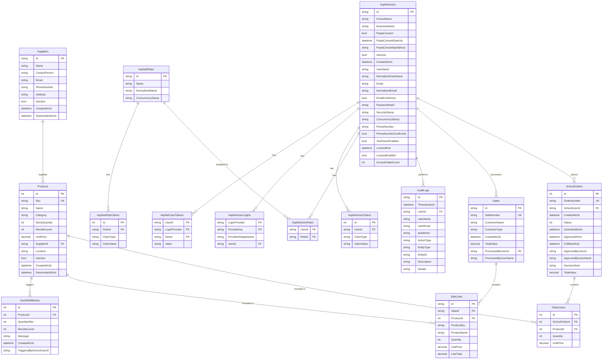

# AutoStockIQ Database Schema



## Legend

- **PK**: Primary Key
- **FK**: Foreign Key
- **UK**: Unique Key
- **||--o{**: One-to-Many relationship
- **||--||**: One-to-One relationship
- **}o--o{**: Many-to-Many relationship

## Key Relationships

1. **AspNetUsers ↔ SchoolOrders**: One user can place multiple school orders
2. **AspNetUsers ↔ Sales**: One user can process multiple sales
3. **SchoolOrders ↔ OrderLines**: One order contains multiple line items
4. **Sales ↔ SaleLines**: One sale contains multiple line items
5. **Products ↔ OrderLines**: One product can appear in multiple order lines
6. **Products ↔ SaleLines**: One product can appear in multiple sale lines
7. **Products ↔ StockRefillAlerts**: One product can trigger multiple refill alerts
8. **Suppliers ↔ Products**: One supplier can supply multiple products
9. **AspNetUsers ↔ AspNetRoles**: Many-to-many relationship via AspNetUserRoles

## Database File Location

The SQLite database file is located at:
```
C:\Users\OG Loner\source\repos\AutoStockIQ\AutoStockIQ\autostockiq.db
```

## Viewing the Diagram

To view this Mermaid diagram:
1. **GitHub/GitLab**: Will render automatically
2. **VS Code**: Install the "Markdown Preview Mermaid Support" extension
3. **Online**: Use https://mermaid.live/ to render the diagram
4. **Notion, Obsidian, etc.**: Many apps support Mermaid natively
